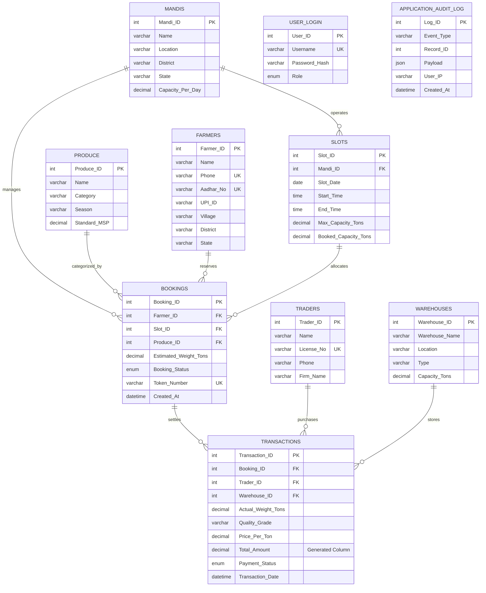

# AgriSlot - Entity-Relationship (ER) Diagram & Schema Specification

This document provides the complete Entity-Relationship specification and Relational Schema architecture for the **AgriSlot APMC Mandi Logistics Management System**.

---

## 1. Visual Entity-Relationship (ER) Diagram

---

## 2. Relational Cardinality & Referential Integrity

| Relationship | Cardinality | Parent Table | Child Table | Foreign Key Column | Delete Rule | Update Rule |
| :--- | :---: | :--- | :--- | :--- | :--- | :--- |
| **Mandi to Slots** | `1 : N` | `Mandis` | `Slots` | `Slots.Mandi_ID` | `RESTRICT` | `CASCADE` |
| **Farmer to Bookings** | `1 : N` | `Farmers` | `Bookings` | `Bookings.Farmer_ID` | `RESTRICT` | `CASCADE` |
| **Slot to Bookings** | `1 : N` | `Slots` | `Bookings` | `Bookings.Slot_ID` | `RESTRICT` | `CASCADE` |
| **Produce to Bookings** | `1 : N` | `Produce` | `Bookings` | `Bookings.Produce_ID` | `RESTRICT` | `CASCADE` |
| **Booking to Transaction**| `1 : 1` | `Bookings` | `Transactions`| `Transactions.Booking_ID` | `CASCADE` | `CASCADE` |
| **Trader to Transactions**| `1 : N` | `Traders` | `Transactions`| `Transactions.Trader_ID` | `RESTRICT` | `CASCADE` |
| **Warehouse to Transactions**| `1 : N` | `Warehouses`| `Transactions`| `Transactions.Warehouse_ID` | `RESTRICT` | `CASCADE` |

---

## 3. Key Constraints & Data Integrity

1. **Pessimistic Concurrency Invariant:**
   $$\sum \text{Bookings.Estimated\_Weight\_Tons} \le \text{Slots.Max\_Capacity\_Tons}$$
   Enforced via `SELECT ... FOR UPDATE` in transaction boundary and verified by AFTER trigger.

2. **Generated Financial Column:**
   $$\text{Transactions.Total\_Amount} = \text{Actual\_Weight\_Tons} \times \text{Price\_Per\_Ton}$$
   Computed natively by MySQL InnoDB engine to prevent arithmetic desynchronization.

3. **Collision-Proof Tokens:**
   - Format: `AG-T` followed by zero-padded sequential integers (e.g., `AG-T001`).
   - Defined as `UNIQUE KEY uk_token (Token_Number)`.

4. **Composite Performance Indexes:**
   - `idx_slots_mandi_date_time (Mandi_ID, Slot_Date, Start_Time)`
   - `idx_bookings_slot_status (Slot_ID, Booking_Status)`
   - `idx_bookings_token (Token_Number)`
