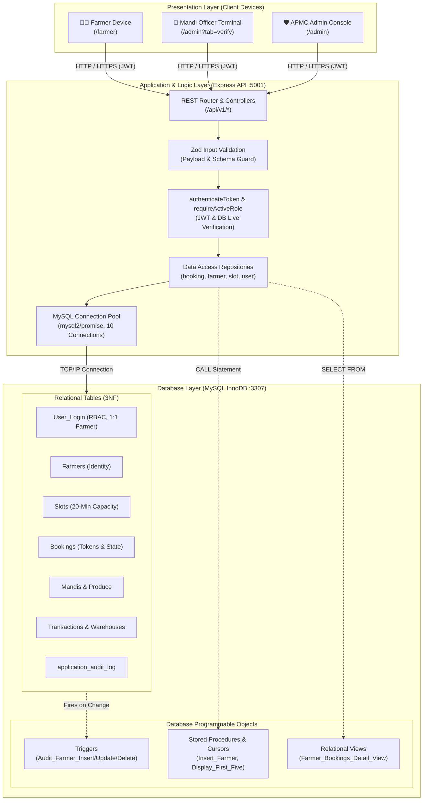
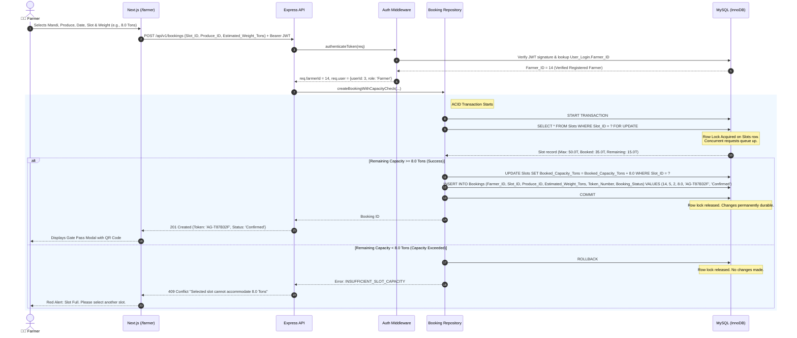
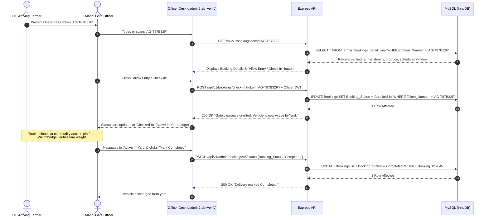

# 02. System Architecture & Data Flow

## 1. High-Level Architectural Paradigm

AgriSlot is built as a classic enterprise **Three-Tier Client-Server Architecture**:

1. **Presentation Layer (Frontend):** Next.js 14 React framework running on Node.js. Delivers responsive single-page interfaces for Farmers (`/farmer`), Mandi Officers (`/admin?tab=verify`), and Administrators (`/admin`), with client-side JWT token handling and real-time state synchronization.
2. **Business Logic & API Layer (Backend):** Node.js and Express RESTful API running on port `5001`. Handles request validation (Zod), JWT authentication, cryptographic token generation, and role-based access control (RBAC).
3. **Data Persistence Layer (Database):** MySQL 8.x relational database running InnoDB engine. Enforces referential integrity, row-level concurrency locking, transactions, stored procedures, cursors, triggers, views, and B-Tree indexes.

---

## 2. System Architecture Diagram

---

## 3. End-to-End Booking Data Flow Sequence

The most critical operational path in the system is booking a 20-minute delivery slot. The sequence below illustrates how AgriSlot maintains zero data overselling across concurrent users:

---

## 4. Gate Clearance & Weighbridge Flow Sequence

When a farmer arrives at the APMC Mandi yard:

---

## 5. Security & Role Separation Safeguards

1. **Live Database Role Validation:** Authentication does not rely solely on the static claims in the JWT token. The `requireActiveRole` middleware executes a fresh lookup against `User_Login` to ensure a revoked or suspended officer cannot perform administrative actions using an unexpired token.
2. **Strict Route Segregation:**
   - `/api/v1/bookings`: Public reading of slot capacity; authenticated farmers can book and cancel their own records.
   - `/api/v1/admin/bookings/*` and `/api/v1/bookings/check-in`: Accessible by both `Mandi_Officer` and `Admin`.
   - `/api/v1/admin/users/*` and `/api/v1/admin/audit-logs`: Strictly restricted to `Admin`. Mandi Officers receive `403 FORBIDDEN`.
