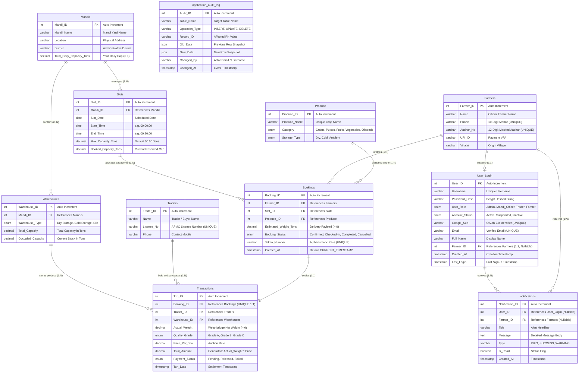

# 03. Entity-Relationship (ER) Diagram & Data Dictionary

## 1. Conceptual & Logical Data Model

The AgriSlot relational data model captures the complete operational lifecycle of an APMC Mandi, including farmer registration, slot scheduling, booking token generation, storage warehousing, trader financial transactions, and RBAC user logins.

---

## 2. Complete Mermaid ER Diagram

---

## 3. Entity & Attribute Dictionary

### 1. `Mandis` (Agricultural Market Yards)
- **Primary Key:** `Mandi_ID` (INT, AUTO_INCREMENT)
- **Business Description:** Stores geographical and structural information for state-regulated APMC market yards.
- **Constraints:** `Total_Daily_Capacity_Tons > 0`.
- **Cardinality:** `1 : N` with `Slots`, `1 : N` with `Warehouses`.

### 2. `Produce` (Commodity Catalog)
- **Primary Key:** `Produce_ID` (INT, AUTO_INCREMENT)
- **Business Description:** Standardized catalog of agricultural crops eligible for mandi trading.
- **Attributes:** `Produce_Name` (VARCHAR UNIQUE), `Category` (ENUM: Grains, Pulses, Fruits, Vegetables, Oilseeds), `Storage_Type` (ENUM: Dry, Cold, Ambient).
- **Cardinality:** `1 : N` with `Bookings`.

### 3. `Farmers` (Agricultural Producers)
- **Primary Key:** `Farmer_ID` (INT, AUTO_INCREMENT)
- **Business Description:** Master identity directory of verified farmers.
- **Attributes:** `Name`, `Phone` (UNIQUE, 10 digits), `Aadhar_No` (UNIQUE, 12 digits masked), `UPI_ID`, `Village`.
- **Cardinality:** `1 : N` with `Bookings`, `1 : 1` with `User_Login`.

### 4. `Slots` (20-Minute Scheduling Windows)
- **Primary Key:** `Slot_ID` (INT, AUTO_INCREMENT)
- **Foreign Key:** `Mandi_ID` REFERENCES `Mandis(Mandi_ID)` ON DELETE CASCADE.
- **Business Description:** Discrete 20-minute operational time blocks.
- **Constraints:**
  - `CHECK (Max_Capacity_Tons > 0)`
  - `CHECK (Booked_Capacity_Tons >= 0 AND Booked_Capacity_Tons <= Max_Capacity_Tons)`
  - `CHECK (End_Time > Start_Time)`
- **Cardinality:** `1 : N` with `Bookings`.

### 5. `Bookings` (Delivery Reservations & Gate Passes)
- **Primary Key:** `Booking_ID` (INT, AUTO_INCREMENT)
- **Foreign Keys:**
  - `Farmer_ID` REFERENCES `Farmers(Farmer_ID)`
  - `Slot_ID` REFERENCES `Slots(Slot_ID)`
  - `Produce_ID` REFERENCES `Produce(Produce_ID)`
- **Attributes:** `Estimated_Weight_Tons` (CHECK > 0), `Booking_Status` (`Confirmed`, `Checked-In`, `Completed`, `Cancelled`), `Token_Number` (UNIQUE pass code, e.g. `AG-T001`).
- **Cardinality:** `1 : 1` with `Transactions`.

### 6. `Warehouses` (Mandi Storage Units)
- **Primary Key:** `Warehouse_ID` (INT, AUTO_INCREMENT)
- **Foreign Key:** `Mandi_ID` REFERENCES `Mandis(Mandi_ID)`.
- **Constraints:** `CHECK (Total_Capacity > 0 AND Occupied_Capacity <= Total_Capacity)`.
- **Cardinality:** `1 : N` with `Transactions`.

### 7. `Traders` (Commission Agents & Buyers)
- **Primary Key:** `Trader_ID` (INT, AUTO_INCREMENT)
- **Attributes:** `Name`, `License_No` (UNIQUE), `Phone`.
- **Cardinality:** `1 : N` with `Transactions`.

### 8. `Transactions` (Financial Settlements)
- **Primary Key:** `Txn_ID` (INT, AUTO_INCREMENT)
- **Foreign Keys:**
  - `Booking_ID` REFERENCES `Bookings(Booking_ID)` (UNIQUE — exactly one transaction per booking)
  - `Trader_ID` REFERENCES `Traders(Trader_ID)`
  - `Warehouse_ID` REFERENCES `Warehouses(Warehouse_ID)`
- **Generated Column:** `Total_Amount DECIMAL(12,2) GENERATED ALWAYS AS (Actual_Weight * Price_Per_Ton) STORED`.
- **Attributes:** `Actual_Weight`, `Quality_Grade`, `Price_Per_Ton`, `Payment_Status` (`Pending`, `Released`, `Failed`).

### 9. `User_Login` (Authentication & RBAC)
- **Primary Key:** `User_ID` (INT, AUTO_INCREMENT)
- **Foreign Key:** `Farmer_ID` REFERENCES `Farmers(Farmer_ID)` ON DELETE SET NULL.
- **Attributes:** `Username` (UNIQUE), `Password_Hash`, `User_Role` (`Admin`, `Mandi_Officer`, `Trader`, `Farmer`), `Account_Status`, `Google_Sub`, `Email` (UNIQUE).

### 10. `application_audit_log` (System Audit Trail)
- **Primary Key:** `Audit_ID` (INT, AUTO_INCREMENT)
- **Attributes:** `Table_Name`, `Operation_Type`, `Record_ID`, `Old_Data` (JSON), `New_Data` (JSON), `Changed_By`, `Changed_At`.

### 11. `notifications` (In-App Notifications)
- **Primary Key:** `Notification_ID` (INT, AUTO_INCREMENT)
- **Foreign Keys:** `User_ID`, `Farmer_ID`.
- **Attributes:** `Title`, `Message`, `Type`, `Is_Read`, `Created_At`.
